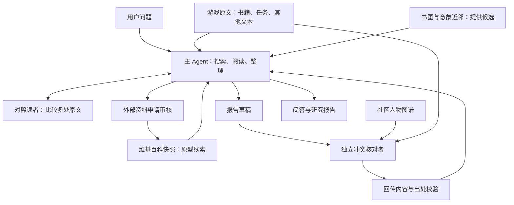

# 原神考据 Agent · Story Agent

从《原神》游戏原文出发的考据 Agent。输入一个口语问题，它会搜索线索、按行回读原文、比较多处证据，输出简答和带出处的研究报告。

这个项目关注一个具体问题：**当答案分散在书籍、任务、角色故事与物品描述中时，Agent 能否主动找证据，并把原文明说、合理推导和猜测分开？**

目前是本地运行的研究原型，已完成七题盲测与逐条原文核查。盲测发现了两处与原文矛盾的定论，后续修复仍暴露了总结阶段的时序错误。项目保留这些结果，用于理解 Agent 的能力与失败方式。

> 如果您是 HR 或考据博主，对该项目感兴趣、想要试用，请联系我的邮箱：[jyuan406@gmail.com](mailto:jyuan406@gmail.com)

## 能做什么

- **主动查原文**：搜索书籍、任务与其他游戏文本，按行读取上下文；读到中途会提示未读完。
- **跨文本比较**：需要时委派对照读者，比较两份材料的说法、对象和时间关系。
- **区分证据强度**：报告使用【明说】【推导】【猜测】；人物说法单独标明，猜测需要原文抓手和检验办法。
- **先核对问题前提**：题目本身含有错误预设时，可以先纠正前提，再回答问题。
- **受控查外部原型**：原文不足时可以申请维基百科资料，由独立审核角色放行；外部资料不能直接证明游戏内事实，相关解释最高列为猜测。
- **隔离社区图谱**：主 Agent 不能直接读取社区人物图谱；独立冲突核对者用它寻找草稿与原文的冲突，经程序校验后回传。
- **保留可审计记录**：保存请求、响应、工具调用、出处、检查结果和 token 用量；支持在问题、配置和源码一致时恢复未完成运行。

## 工作方式



当前主线是一个主 Agent 配合按需使用的辅助角色。早期尝试过读者、黑板、假说、回读、认证等多层流水线；这些实验代码保留用于回放，已经退出当前默认路径。

代码重点在工具边界、原文定位、委派与复核、报告检查、失败恢复和费用计量。Agent 执行复用 Deep Agents / LangGraph；模型调用复用 LangChain 与 HTTPX。Graphiti / Neo4j 属于早期持久研究图实验，当前命令行入口不要求启动 Neo4j。

## 示例

下面是实际盲测的三个案例摘要，均附核查发现；摘要经过人工整理，不是模型报告原文。

| 问题 | 观察到的行为 | 案例 |
|---|---|---|
| 蒙德骑士团的大团长是谁，现在在哪？ | 综合不同任务中的身份、远征和返回信息，区分当前位置与未来计划 | [身份与时序](docs/reports/public-examples/grand-master.md) |
| 雪山古国经历了什么？ | 跨书籍、物品和任务整理事件；冲突核对纠正了一处草稿事实，最终仍有无充分支持的说法 | [跨来源叙事](docs/reports/public-examples/snow-mountain.md) |
| 钟离当年为什么要亲手杀死若陀龙王？ | 先核对并纠正题面中的“杀死”前提；最终仍有跨时段推断依据不足的问题 | [错误前提](docs/reports/public-examples/azhdaha.md) |

所有结论都受本次固定语料快照限制，“现在”指该次快照中的剧情状态。

## 评测结果与局限

2026-11-08 核查的七题盲测使用 `deepseek-v4-pro`，开启 thinking，`reasoning_effort=max`。每题一次运行，故障通过保留证据的断点恢复处理。执行过程中有格式、空回复及文件写入修订，因此结果对应 `v0.95.1–v0.95.4`，不能说成同一个未变化版本的七次测试。

| 项目 | 结果 |
|---|---:|
| 研究报告 | 7 / 7 |
| 对话总结 | 6 / 7 |
| 与原文矛盾的定论（C1） | 2 处，质量门槛未通过 |
| 无充分支持的说法 | 7 组 |
| 重要隐藏内容遗漏 | 2 项，核查者判断 |
| 预算 token：未命中输入＋输出 | 2,127,996 |
| 缓存命中输入 token，单独计列 | 21,563,008 |

这些是小样本人工辅助核查结果，不能换算成总体准确率，也没有证明优于 RAG。完整公开摘要见[评测说明](docs/reports/public-evaluation.md)。

已知问题包括：读到了证据却未整合进结论；混淆人物自述与后文身份反转；误读代际和事件先后；简答压缩丢失限定条件；部分报告漏写总结或出处不完整。引用可以定位、格式检查通过，都不能证明语义正确。

`v0.95.5` 修复了冲突核对回传中多处行号的校验问题。在单题接续验证中，原身份错误改正，但总结新增了一处时序错误。这次修复验证不覆盖原七题成绩，也不代表质量门槛已经通过。

## 运行条件与命令行

**完整的干净环境安装流程尚未验证。** 默认链路依赖未随代码分发的游戏原文、书图、意象近邻缓存和社区图谱快照；凭据入口与部分冻结 manifest 还保留开发环境路径。仅安装 Python 依赖不足以运行完整研究流程；想试用请通过上方邮箱联系。

开发环境使用 Windows、Python 3.12 和项目独立 Conda 环境，避免向 `base` 安装依赖。主要依赖版本见 [requirements.in](requirements.in)，完整冻结依赖见 [requirements.lock.txt](requirements.lock.txt)。

在所需语料、缓存与凭据已就绪的开发环境中，从项目根目录运行：

```powershell
$env:PYTHONUTF8 = '1'
$env:PYTHONIOENCODING = 'utf-8'
$env:PYTHONNOUSERSITE = '1'

& .\.envs\story-agent\python.exe -s scripts/ask.py `
  --question '雪山古国经历了什么？' `
  --out .runtime/answers/snow-mountain `
  --cap 1750000
```

`scripts/ask.py` 对应冻结的 `default-v1.1 / v0.95.2`；包含后续冲突出处校验修复的入口为 `scripts/ask_v955.py`，参数相同。历史版本分别保留，不会让旧实验结果随新代码改变。

`--cap` 控制未命中输入与输出的实际累计 token，不是人民币或美元上限；超过后停止后续请求，已发出的请求仍可能产生费用。缓存命中输入另行计量，运行记录中的其他 total 字段可能包含它。具体实现见 [wire_default_v1.py](story_agent/wire_default_v1.py)。

| 输出 | 内容 |
|---|---|
| `summary.md` | 给提问者的简答；缺失时会记录诊断 |
| `report.md` | 研究正文、分级结论、出处及运行信息 |
| `cost.json` | token 用量、缓存与失败统计 |
| `trace.jsonl`、`calls/` | 工具过程、请求与响应，本地保留 |
| `config.json`、`checkpoint.json` | 配置绑定与恢复状态 |
| `result.json` | 执行结果及格式诊断；执行完成不等于语义核查通过 |

未完成运行可在相同命令末尾加 `--resume`。题面、上限、配置和源码必须一致；已完成目录拒绝覆盖。跨版本恢复需要单独验证，不能直接改配置绕过检查。

运行时，问题、读取到的原文及工具结果会发送给已配置的 DeepSeek API。外部原型工具可以请求中文和英文维基百科。凭据只用于认证，运行轨迹应留在本地。

## 源码导航

| 入口 / 模块 | 用途 |
|---|---|
| [scripts/ask.py](scripts/ask.py)、[scripts/ask_v955.py](scripts/ask_v955.py) | 命令行、恢复和运行记录 |
| [default_v1.py](story_agent/default_v1.py)、[default_v955.py](story_agent/default_v955.py) | 默认配置与组件组合 |
| [agent_tl5b.py](story_agent/agent_tl5b.py) | 主 Agent 提示与组装 |
| [search_tl5b_v942.py](story_agent/search_tl5b_v942.py) | 游戏文本搜索与截断处理 |
| [agent_tools_tl1.py](story_agent/agent_tools_tl1.py)、[texts_tl4.py](story_agent/texts_tl4.py) | 原文读取、书目浏览与文本来源 |
| [conflict_check_default_v955.py](story_agent/conflict_check_default_v955.py) | 隔离图谱冲突核对与出处校验 |
| [external_pt0_v921.py](story_agent/external_pt0_v921.py) | 外部资料读取与快照 |
| [wire_default_v1.py](story_agent/wire_default_v1.py)、[wire_default_v955.py](story_agent/wire_default_v955.py) | 请求记录、计量和失败恢复 |
| [tests/](tests/) | 离线测试；部分历史回放依赖本地证据 |

文件名带实验编号是为了冻结行为和保留失败证据。它增加了阅读成本，模块整理属于后续工作。

## 数据来源、许可与贡献说明

- 游戏文本使用固定的 Istaroth 语料快照；社区人物图谱来自 `Houraiji/genshin-lore-graph`。游戏原文用于取证，社区图谱用于候选和冲突核对。
- 游戏原文、第三方图谱、模型权重、本地数据库、完整请求响应和私人协作文档不随源码分发。示例页仅提供整理后的行为与核查摘要。
- 项目代码以 MIT 许可证发布，见 [LICENSE](LICENSE)。MIT 只覆盖本项目代码，不覆盖游戏文本和第三方图谱，这些材料的使用条件需分别核对。
- 项目作者提出研究目标、证据边界和关键取舍；开发与文档整理使用了 Claude、Codex 等 AI 工具辅助。评测由 Codex 辅助逐条回原文核查、Claude 抽查，不是独立第三方基准。
- 本项目为非官方学习与研究项目。《原神》相关名称与游戏内容的权利属于各自权利人。
